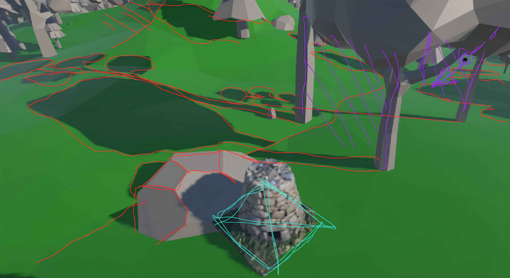
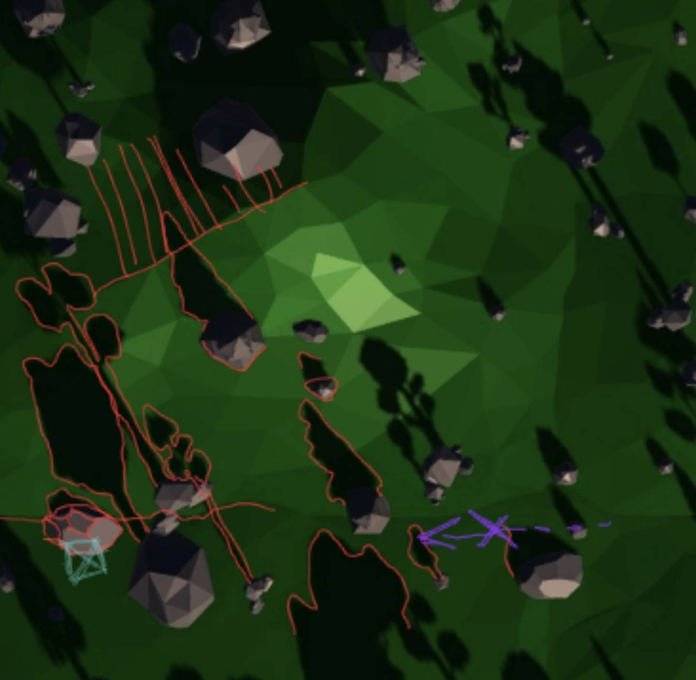
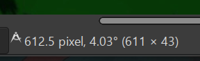

# Open Source Sardinialence — Writeup

**Category:** OSINT / rev

**Author:** milka-cookies, SannaZ

**Description** They are attacking the island!!! Find the cannon's coordinates.

**Flag format** srdnlen{X_Z}, where X and Z are the in-game coordinates (sign included and ±3.0 range) with exactly one decimal digit.

## 1. Locate the Nuraghe and understand the direction of the cannonball

Within just a few minutes, most of you have probably already identified the Nuraghe's position on the minimap by correlating shadows and terrain features with the video.

Determining the exact direction from which the cannonball is fired requires a a more thorough analysis. You need to examine the video frame by frame, identifying the objects it passes along the way. By locating the cannonball on the minimap at the very first frame in which becomes visible, you can establish its incoming direction with greater accuracy.

## 2. Unity Reverse Engineering

By reversing the build you'll quickly acknowledge that the spawning distance of the Cannon to the Nuraghe is set at 160.
The four dots in the minimap (called "North", "South", "West", "East"), are located in the edges of the map at the exact coordinates: [[0,250], [0,-250], [250,0], [-250,0]].

## 3. Nuraghe Coordinates

Using the four cardinal markers as reference points, you can establish a pixel-to-world coordinate ratio for the minimap. Since the map spans from -250 to +250 on both the X and Z axes, each pixel can be mapped to its corresponding world coordinate using basic math.

Nuraghe 1173,1666

West 318,1280

East 2242,1280

North 1280,318

South 1280,2242

X = ((1173-318)500)/(1924)-250 = -27,93

Z = 250-((1666-318)500)/(1924) = -100,52

## 4. Cannon Coordinates

Now use basic trigonometry to calculate the Cannon coordinates at distance 160 after you found the angle.

ΔX = 160 cos(4.03°) = +159.60

ΔZ = 160 sin(4.03°) = +11.25

and then

X = -27.93 + 159.60

Z = -100.52 + 11.25

## 5. Flag

**srdnlen{131.6_−89.2}**
(the exact position was x=131.6,z=-88.1 but the flag has ±3.0 range)
