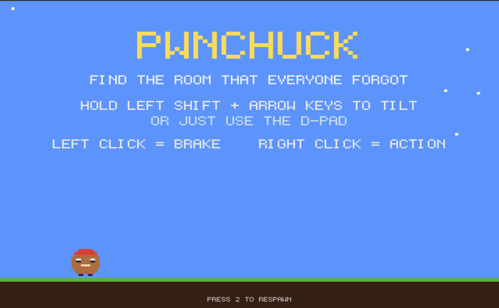
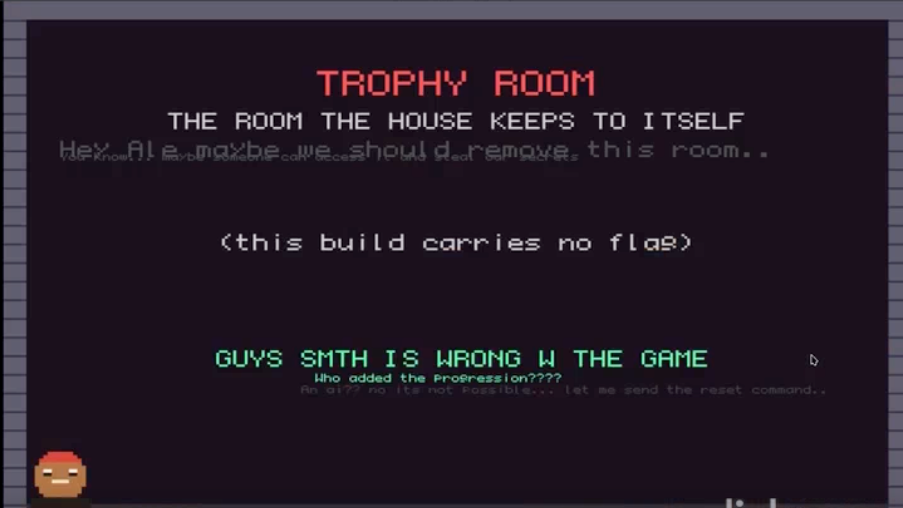

# Pwnchuck

---




**Tags: `(medium) (Pwn) (PPC) (Game) (WIi) (Cybercamp)`
CTF: Sardinia CyberCamp 2026
Authors: @alessaba @NicolaSerreli @caino**

# Challenge Description

> 
> 
> 
> A mansion of four rooms, a remote that tilts, and a weird dude called Chuck.
> Its books are balanced, its map is complete, and its walls are very sure of themselves.
> Find the room the map forgot, and bring back what it is hiding.
> 
> Find the solve on the [emulator](https://dolphin-emu.org/download) first, then come to the Wii station to reproduce the steps with the WiiMote and get your flag
> 

The challenge consists of a simple Wii Homebrew game where you move a character named Chuck through 3 rooms. There are actually 4 rooms in the game, but one of them (the flag room) is inaccessible by regular means and requires a 2 stage exploit.

**The flag is stored inside a room witch is only accessible by overwriting the `roomID` with an out of bounds vulnerability combined with an integer overflow.**

---

### Analysis


Using the  `checksec` tool from `pwntools`  ,we can see that the file has: 
• No PIE
• No RELRO
• No Canary.

Opening it on a decompiler the first thing that we see is that the program **has symbols**.

Checking the `game_Init()` function there’s a strange call to a function called `ledger_reset()` 

```c
void game_init()
{
  ASND_Pause(0);
  ASND_Pause(1);
  rooms_init();
  torches_init();
  physics_reset(&player);
  hints_taken = 0;
  idle_frames = 0;
  ledger_reset();
  player.remaining_frames = 1800;
  memset(bursts, 0, sizeof(bursts));
  show_title = 1;
}
```

Looking deep into it, we see that the function clears an array called `page`, sets the `leaning`, `writing`, and `light` variables to their default values.

```c
void ledger_reset(void)

{
  page[0] = '\0';
  page[1] = '\0';
  page[2] = '\0';
  page[3] = '\0';
  page[4] = '\0';
  page[5] = '\0';
  page[6] = '\0';
  page[7] = '\0';
  
  light = 0;
  written = '\0';
  leaning = 0xff;
  return;
}
```

**[NOTE]: The actual array has size 8, but in some decompilers it is shown as 4 QWORDS.**

Looking into `game_update()` we see that there are a couple of functions related to `ledger_reset()`,  witch are `ledger_set_light()` and `ledger_note_tilt()` .

Inside `ledger_set_light()` we can see that the function sets the `light` variable (witch is used as 8 bit value) with `total` (witch is 16 bit).
When the overflow happens, it overwrites the high part, making `leger_dbg_mode()` become **1**, making the game call `ledger_note_tilt()` 

```jsx
void ledger_set_light(u16 total)

{
  light = total; //light is the value that changes with each torch placement 
  return;
}

bool ledger_dbg_mode(void) 
{
	return HIGHBYTE(light) != 0; //If the highest bit of the variable are not zero returns true (the overflow worked)
}
	  
```

When the debug mode is active, `ledger_note_tilt()` registers 8 direction changes to a buffer of size 8. In the code we can notice that when we can overflow writing on cell more (index 8). Then the function `rooms_step()`, will use the 8th index as the next room that the player goes to, meaning that if the last move is left when crossing the right door and down when crossing the left side you go inside the win room.

```c
  void ledger_note_tilt(s16 tilt_x, s16 tilt_y){
	u8 v4; // Leaning position

/*Conversion change detection code */
  [...] 
  
 /* Exploitable code */
  leaning = v4; 
  v7 = written;
  if ( written <= 7u ) //page is declared with a size of 8
  {
    ++written; // if written is 7 goes out of bounds
    page[v7] = v4; 
  }
  return;
}

void rooms_step(){

	[...]

  if ( ledger_dbg_mode() )
    v8 = *(ledger_steps() + 1);
  else
    LOBYTE(v8) = next_1;
  p->room = v8;
  
 }
```

---

# Solution

From the analysis done, we can easily determine what to do:

1. Collect the 16 torches without loosing in the maze → We need all of them to reach 256 light value
2. Place all the torches making sure to place them closely → This overflows the 8-bit `lightValue` setting the `debugFlag` flag to **1**
3. With the `debugFlag` set, the second vulnerability is now exploitable. In this “mode”, an oversized local buffer containing the direction changes is copied into the global buffer (***off-by-one)***, which is adjacent to the `roomID` variable.
4. Make some direction changes after you enter a room, making sure that.
    
    ```c
    #define MOVE_LEFT 0
    #define MOVE_RIGHT 1
    #define MOVE_UP 2
    #define MOVE_DOWN 3
    // (in this case: left → up → down → up → down → up → down → up → down) 
    ```
    
     The **9th** one is the downwards in order to set the `RoomID` to 3 witch is `SecretRoom` 
    
5. Move to the side to change room → The `room_change()` function should teleport Chuck to the secret room!



#### **Flag:  `srdnlen{wh3Re_th3_chuCk_d1d_y0U_G0}`**

# Solve Video

[clideo_editor_b249a57328ab4243bb8caac2c0d94e15.mp4](media/clideo_editor_b249a57328ab4243bb8caac2c0d94e15.mp4)

# Links and tools used

- [Dolphin emulator](https://dolphin-emu.org/)
- [Ghidra](https://github.com/nationalsecurityagency/ghidra)