# Dante's Inferno

## 1. Challenge summary

The ROM is a small Game Boy Advance game built with Butano. Dante walks through five scenes inspired by the *Inferno*. Progress is controlled by a stage number, and every stage dispatches the submitted text to a different checker.

## 2. Analysis setup

### Importing the ROM

Import `danteInferno.gba` as a raw binary; depending on the adopted reverse engineering tool and plugins the decompiled code may appear very differently. Also, Butano contributes a large amount of engine code, so beginning at the entry point and reading every function is kinda inefficient. The useful route is to search for visible scene strings and follow their cross references.

These references lead to the main state machine. Near the submit logic, one dispatcher switches on the current stage and calls one of five boolean checkers.

Conceptually, the dispatcher looks like this:

```cpp
switch(stage)
{
    case 0: return check_dark_wood(answer);
    case 1: return check_charon(answer);
    case 2: return check_dis(answer);
    case 3: return check_ulysses(answer);
    case 4: return check_lucifer(answer);
}
```


## 3. Game controls

- D-pad: move Dante; Left/Right select an input character.
- A: interact, append the selected character, or continue.
- B: delete the last input character.
- START: submit the current answer.
- SELECT: leave the input screen.

## 4. Gate 1: Dark Wood

### Finding the checker

Search for `DARK WOOD`, follow its reference to the chapter table, and then
follow the stage-zero branch of the answer dispatcher. The checker first tests
the answer length and then performs one indexed byte lookup for every character.

Cleaned-up decompiler output is:

```cpp
bool check_dark_wood(const byte* input, int length)
{
    if(length != 9)
        return false;

    byte mismatch = 0;
    for(int i = 0; i < 9; ++i)
        mismatch |= sbox[input[i]] ^ target[i];

    return mismatch == 0;
}
```

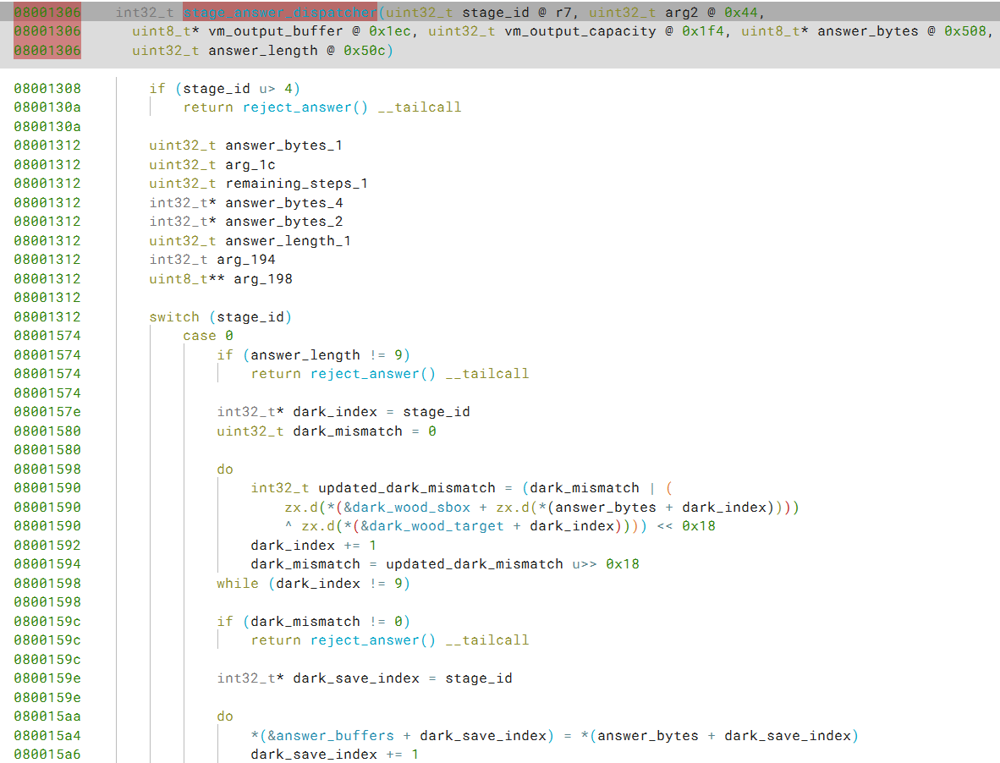

The mismatch is accumulated across all nine positions. A debugger can still
observe the table lookups, but there is no first-wrong-character timing oracle.

The nine target bytes are:

```text
9B 70 09 3D F4 83 19 4A D0
```

The indexed object is exactly 256 bytes long. Since every possible byte appears
once, it is a permutation rather than a conventional many-to-one S-box. That
means each target byte has one unique preimage.

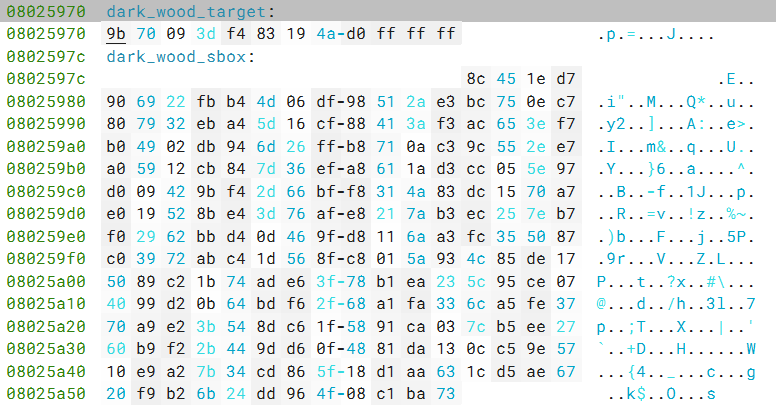

### Recovering the answer

Select the 256 bytes beginning at the lookup-table address and export the selection as `dark_wood_sbox.bin`. Then run:

```python
from pathlib import Path

sbox = Path("dark_wood_sbox.bin").read_bytes()
target = bytes.fromhex("9B 70 09 3D F4 83 19 4A D0")

assert len(sbox) == 256
assert len(set(sbox)) == 256

inverse = [0] * 256
for input_byte, output_byte in enumerate(sbox):
    inverse[output_byte] = input_byte

answer = bytes(inverse[byte] for byte in target)
print(answer.decode("ascii"))
```

Output:

```text
GREYHOUND
```

As a manual check, the first character is `G` (`0x47`) because `sbox[0x47] == 0x9B`. Repeating the lookup for all nine target bytes spells `GREYHOUND`.

Entering the word advances the game to Charon.

## 5. Gate 2: Charon

### Recognizing the real value

The Charon checker copies the submitted text into an EWRAM buffer, parses it as
decimal, and compares it with an obfuscated pointer difference. The two buffers
belong to one aligned structure:

```cpp
struct alignas(4) answer_buffers
{
    char dark_wood[24];
    char charon[24];
};
```

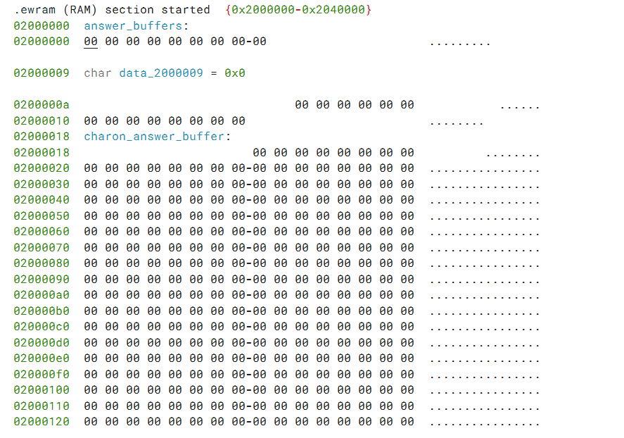

The calculation is:

```cpp
previous = &buffers.dark_wood[0];
current  = &buffers.charon[0];
distance = current - previous;

mist     = ((distance ^ 0x5A) + 0x31) ^ 0x31;
expected = mist ^ 0x5A;
```


### Calculating the answer

Each buffer is 24 bytes (`0x18`), and no padding is inserted between two arrays
of `char`. Therefore:

```text
distance = 0x18 = 24
```

The obfuscation evaluates as follows:

```text
24 XOR 0x5A = 0x42
0x42 + 0x31 = 0x73
0x73 XOR 0x31 = 0x42
0x42 XOR 0x5A = 0x18 = 24
```


The parser rejects leading zeroes and checks for signed 32-bit overflow before
every multiply/add step.

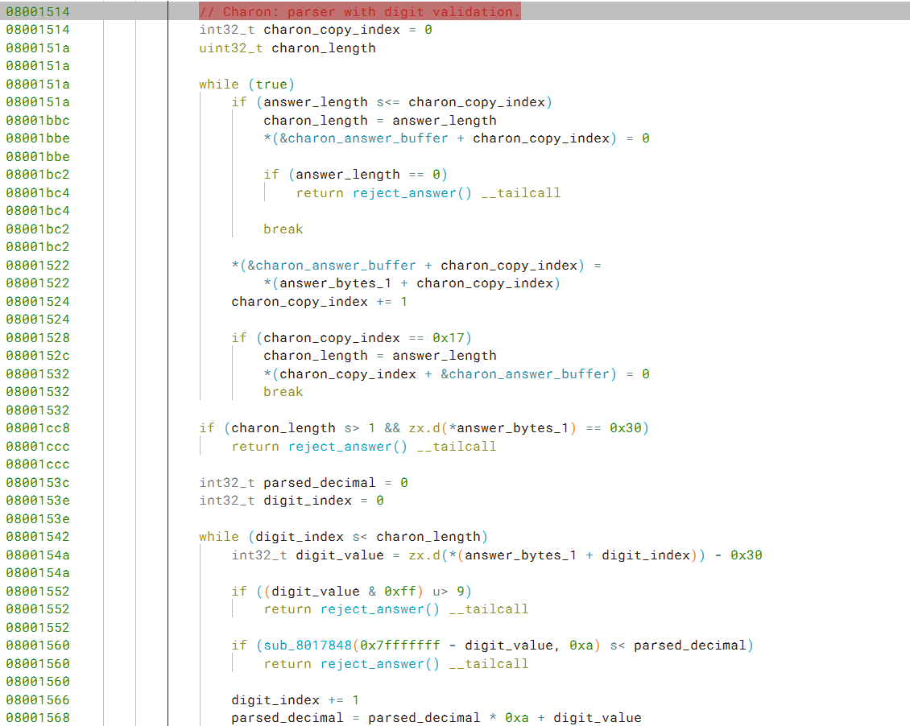

### Dynamic confirmation

In mGBA, break immediately before the integer comparison. The two EWRAM addresses differ by `0x18`, and the expected-value register also contains `0x18`. This confirms the static result without requiring symbols.

## 6. Gate 3: Gates of Dis

### Understanding the simulated host

Since GBA no ordinary network stack, this stage models "simulates" the requested host interaction inside the ROM. The screen cycles through fingerprints as if they were arriving from a service. Five file records are embedded in the ROM, but only their paths are plain strings. Their bodies are stored as encoded byte arrays.

Each record has this logical form:

```cpp
struct remote_file
{
    const char* path;
    const uint8_t* encoded_body;
    uint8_t length;
    uint8_t nonce;
};
```

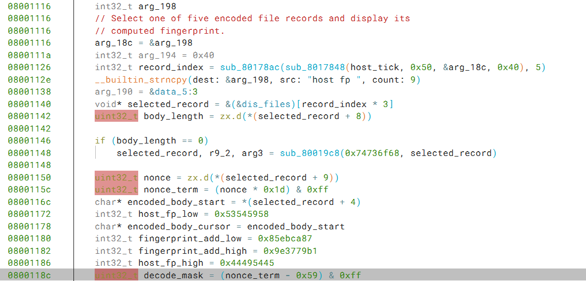

The paths, lengths, and nonces are:

| Index | Path | Length | Nonce |
| ---: | --- | ---: | ---: |
| 0 | `limbo/register.txt` | 16 | `0x13` |
| 1 | `styx/mud.bin` | 11 | `0x37` |
| 2 | `dis/messenger.sig` | 39 | `0x59` |
| 3 | `dis/heresy.log` | 25 | `0x7B` |
| 4 | `dis/walls.txt` | 20 | `0x9D` |

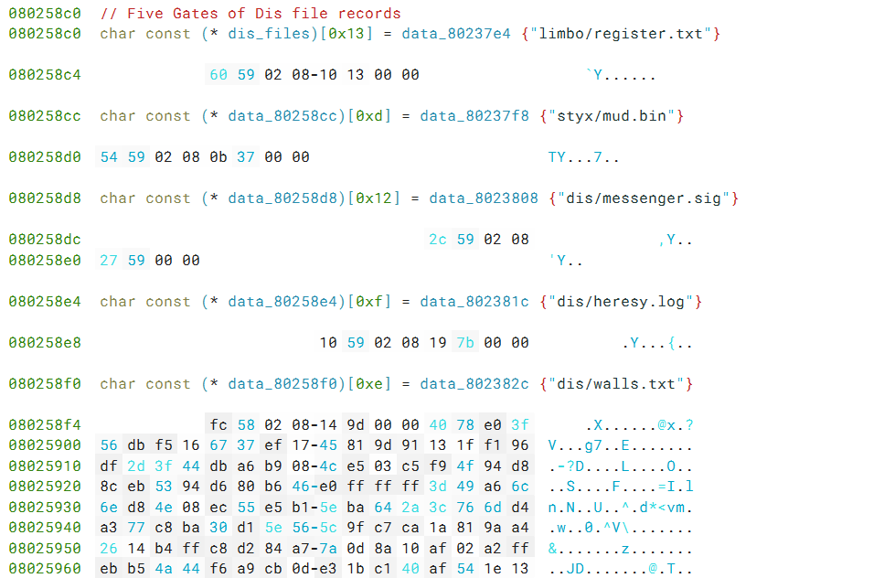

### Decoding the file bodies

For byte position `i`, the ROM computes a rotation and one-byte mask:

```text
rotation = ((i + nonce) MOD 7) + 1
mask = (0xA7 + nonce * 0x1D + i * 0x3B) AND 0xFF
body[i] = ROR8(encoded[i], rotation) XOR mask
```

The transformation is intentionally reversible but prevents the complete body
from appearing as ASCII in ROM. Recover the arrays by following references from
the record table, then apply the formula to each one.

For example, record 2 starts with these encoded bytes:

```text
3D 49 A6 6C 6E D8 4E 08 EC 55 E5 B1 5E BA 64 2A ...
```

Using nonce `0x59` decodes the first bytes to `Heavenly...`.

### Reversing the 64 bit fingerprint

The fingerprint state begins with `0x4449544553545958`, which contains the
ASCII-like markers `DITE` and `STYX`. It updates once per decoded byte:

```cpp
uint64_t fingerprint_step(uint64_t fp, uint8_t byte, int index)
{
    fp = rol64(fp ^ byte, 11);
    fp += (index + 1) * 0x9E3779B185EBCA87;
    fp ^= fp >> 17;
    return fp;
}
```

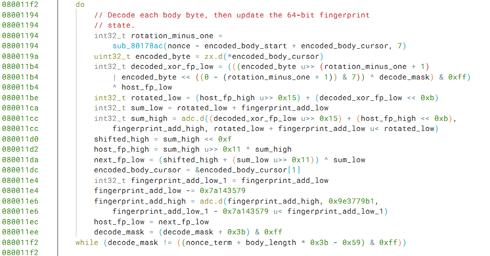

All operations wrap modulo `2^64`. Every submitted byte is absorbed, so the
fingerprint is naturally sensitive to both contents and length. There is no
separate expected-length comparison and no target record index in the checker.

### Recovering the requested fingerprint

The checker reconstructs its requested fingerprint from two independently
masked 32-bit words:

```text
low  = 0x0D5533A9 XOR 0xA6D9345C = 0xAB8C07F5
high = 0xCE70F311 XOR 0x37C2E19A = 0xF9B2128B

target = (high << 32) OR low
       = 0xF9B2128BAB8C07F5
```

These words do not refer to an entry in the file table. Consequently, knowing
the record ordering or noticing that their lengths differ does not identify the
answer. The fingerprint algorithm must be reproduced and applied to the decoded
records.

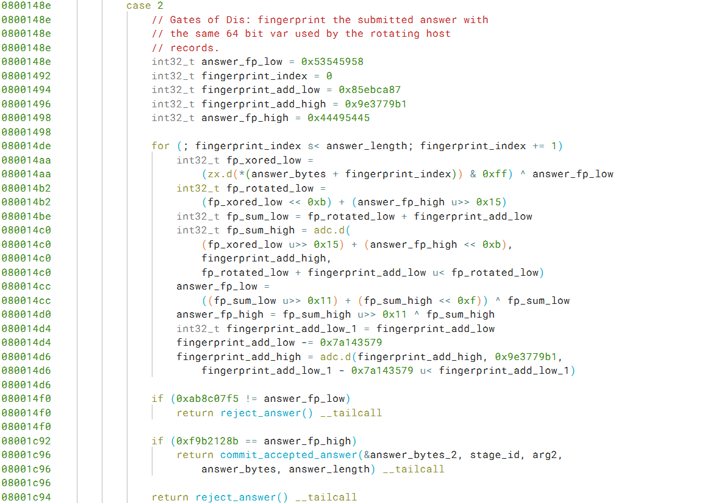

### Reproducing the records

The complete extraction and fingerprint implementation is provided in
`solve/dis_solver.py`:

```sh
python solve/dis_solver.py
```

Output:

```text
Requested fingerprint: F9B2128BAB8C07F5

C11D24A20B03B9A8  limbo/register.txt    abandon_all_hope
8931FA9C3702A80C  styx/mud.bin          stygian_mud
F9B2128BAB8C07F5  dis/messenger.sig     HeavenlyMessenger:OPEN_THE_GATES_OF_DIS
C3D49DA37D05C807  dis/heresy.log        heretics_beneath_the_iron
3D74C8CE5441FEBF  dis/walls.txt         the_walls_are_silent
```

Only `dis/messenger.sig` has the requested fingerprint `F9B2128BAB8C07F5`. Therefore its decoded body is the answer:

```text
HeavenlyMessenger:OPEN_THE_GATES_OF_DIS
```

## 7. Gate 4: Malebolge and Ulysses

This stage combines a short encoded bytecode program, scattered input storage, partial per-character constraints, a checksum, and a standard FNV-1a hash. The memory seal reduces the search space to a few dozen candidates; emulating the
reachable VM loop then selects the answer.

### 7.1 Locating and parsing the VM image

Search the ROM for the four bytes `44 56 4D 31`, which spell `DVM1`. Interpret
the following header fields as little-endian values:

| Offset | Size | Meaning | Value |
| ---: | ---: | --- | --- |
| `0x00` | 4 | Magic | `DVM1` |
| `0x04` | 4 | Encoded code length | `9` |
| `0x08` | 4 | Initial memory length | `0` |
| `0x0C` | 4 | VM seed | `0` |
| `0x10` | 4 | Expected hash, low half | `0x28077EAA` |
| `0x14` | 4 | Expected hash, high half | `0xAA18950B` |
| `0x18` | 4 | Guard metadata | `0x534255AF` |
| `0x1C` | 12 | Shards, checksum, and decoys | `8E 32 3A C2 69 0F CD 9D 87 39 C7 51` |
| `0x28` | 9 | Encoded bytecode | payload |

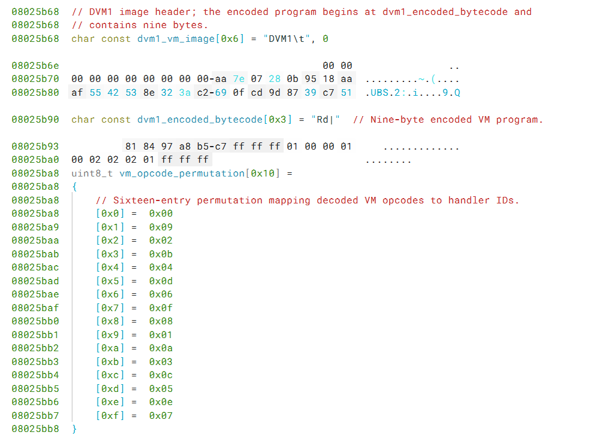

The complete expected hash is assembled high-half first:

```text
expected = 0xAA18950B28077EAA
```

### 7.2 Decoding instructions

At bytecode position `pos`, decode a raw byte with:

```text
key     = (pos * 13 + seed + 0x5A) AND 0xFF
decoded = raw XOR key
argument = decoded >> 4
opcode   = perm16[decoded AND 0x0F]
```

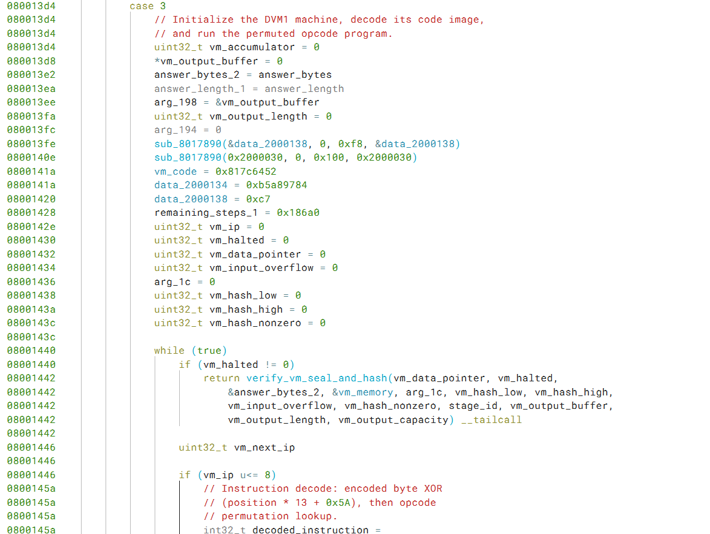

The low-nibble permutation is:

```text
00 09 02 0B 04 0D 06 0F 08 01 0A 03 0C 05 0E 07
```

After applying it, the opcode numbers mean:

| Opcode | Instruction | Effect |
| ---: | --- | --- |
| 0 | `NOP` | No operation |
| 1 | `ADP` | Add the argument to the data pointer |
| 2 | `LDA` | Load `mem[dp]` into accumulator A |
| 3 | `STA` | Store A into `mem[dp]` |
| 4 | `XOR` | XOR A with `mem[dp]` |
| 5 | `ADD` | Add `mem[dp]` to A |
| 6 | `ROL` | Rotate A left |
| 7 | `CRZ` | Apply the ternary crazy operation |
| 8 | `IN` | Read one input byte into A |
| 9 | `OUT` | Write A |
| 10 | `MIX` | Mix A and the data pointer into state B |
| 11 | `JZ` | Jump to a decoded 16-bit target if A is zero |
| 12 | `JMP` | Jump to a decoded 16-bit target |
| 13 | `HALT` | Stop execution |
| 14 | `SDP8` | Set the data pointer from the next decoded byte |
| 15 | `BZ` | Set A according to whether B is zero |

`JZ` and `JMP` consume two additional decoded bytes. `SDP8` consumes one.

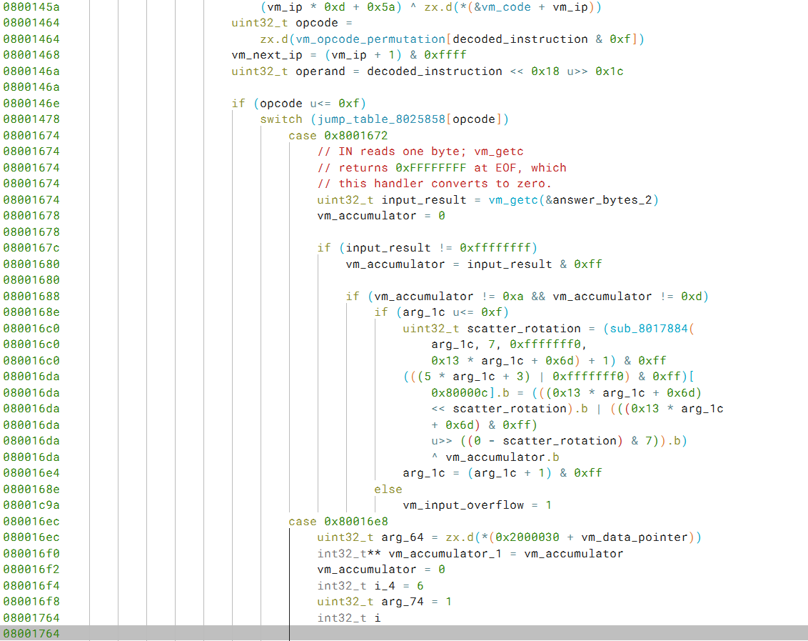

### 7.3 Recovering the control flow

The image contains only nine encoded instruction bytes. Decoding them produces:

```text
0000: IN
0001: JZ  0008
0004: MIX
0005: JMP 0000
0008: HALT
```

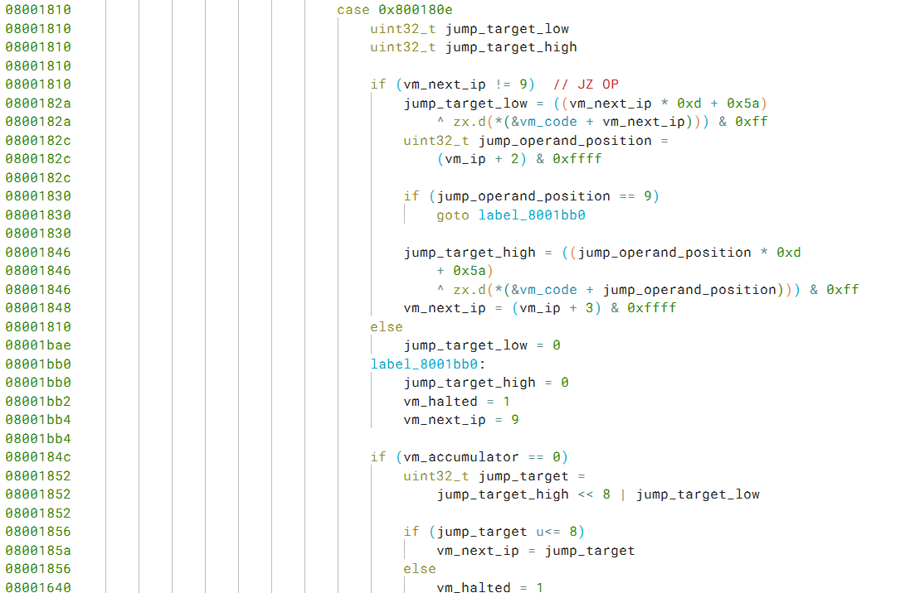

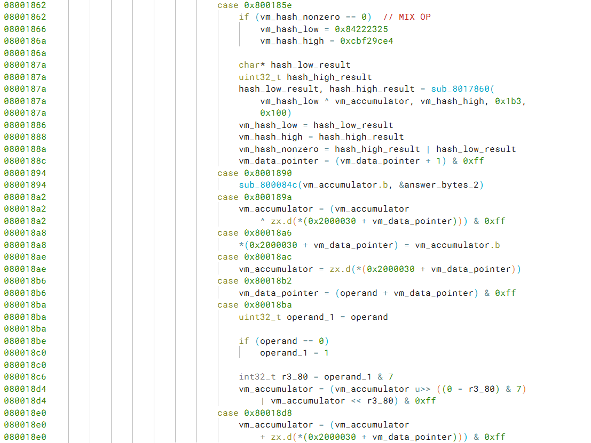

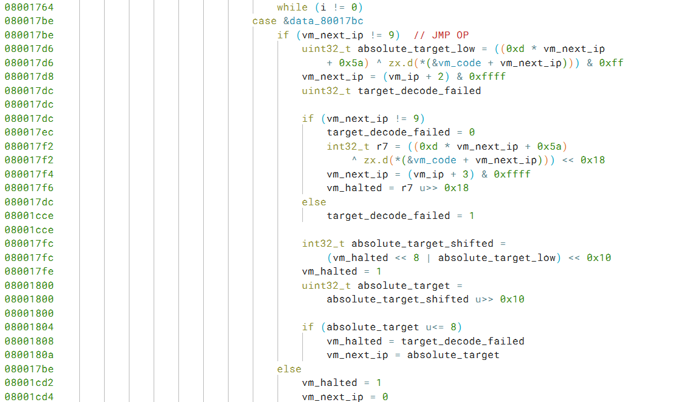

The program is simply:

```cpp
for(;;)
{
    A = read_byte();
    if(A == 0)
        break;
    mix(A);
}
halt();
```

The game input callback returns EOF after the submitted string, and the VM maps
EOF to zero. This is what terminates the loop.

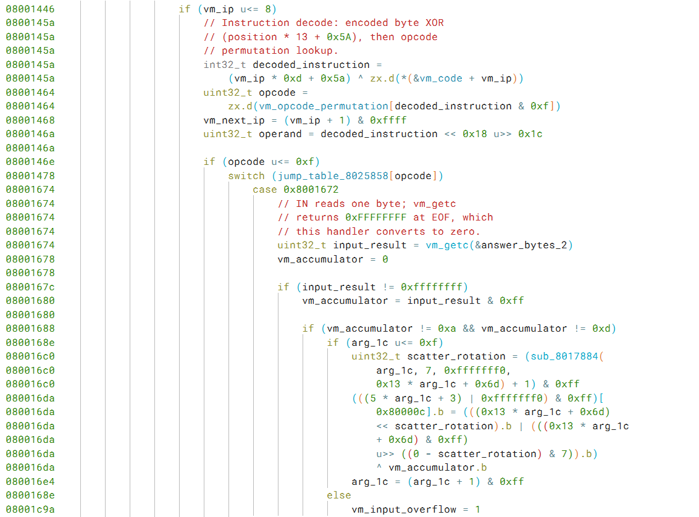

### 7.4 Recovering the hidden length

The upper 24 bits of `guard_meta` must equal `0x534255`, an internal `SBU`
signature. The low byte hides the required input length:

```text
length = (guard_meta XOR 0x534255A7) AND 0xFF
       = (0x534255AF XOR 0x534255A7) AND 0xFF
       = 8
```

Therefore, only eight character inputs can pass the memory seal.

### 7.5 Understanding scattered input storage

Whenever `IN` receives a nonzero input byte, the VM does not store it
contiguously. Character `i` is placed in one of the final 16 memory bytes:

```text
slot = (i * 5 + 3) AND 0x0F
rotation = (i MOD 7) + 1
mask = ROL8(seed + 0x6D + i * 19, rotation)

mem[0xF0 + slot] = input[i] XOR mask
```

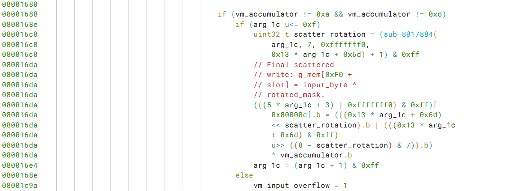

For eight characters, the storage slots are:

```text
i:       0  1  2  3  4  5  6  7
slot:    3  8 13  2  7 12  1  6
address: F3 F8 FD F2 F7 FC F1 F6
```

The verifier reconstructs a character by reading the same slot and applying the
same XOR mask. In a debugger, pausing after the final `IN` shows apparently
unrelated bytes spread between `mem[0xF1]` and `mem[0xFD]` rather than the key.

### 7.6 Reversing the partial shard constraints

The seal checks five transformed bits of each character. It is a search-space
filter, not a second complete password checker. For character
index `i`, first compute:

```text
rotation = (i MOD 7) + 1
salt     = (0x31 + i * 11) AND 0xFF
addend   = (0x5C + i * 17) AND 0xFF

shard = ROL8((SBOX(input[i] XOR salt) + addend) AND 0xFF, rotation)
```

The S-box is an affine permutation:

```text
SBOX(x) = (29 * x + 37) AND 0xFF
```

The expected shard is stored in permuted and masked order. A second rotating mask chooses the five bits that actually matter:

```text
guard_slot    = (i * 3 + 2) MOD 8
expected      = guard[guard_slot] XOR ((0xA5 + guard_slot * 13) AND 0xFF)
constraint    = ROL8(0x1F, i * 3 + 1)

valid if ((shard XOR expected) AND constraint) == 0
```

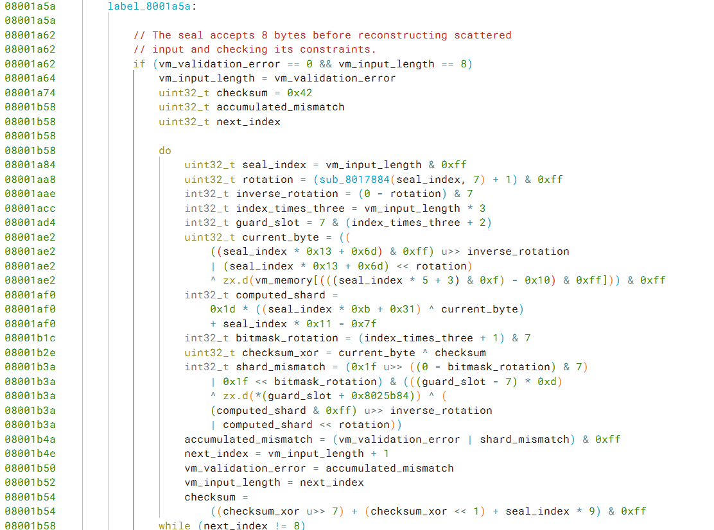

Unmasking the data and testing the printable game alphabet produces these sets:

| `i` | Slot | Stored | Expected | Bit mask | Allowed printable characters |
| ---: | ---: | ---: | ---: | ---: | --- |
| 0 | 2 | `3A` | `85` | `3E` | `$Dd` |
| 1 | 5 | `0F` | `E9` | `F1` | `"4o` |
| 2 | 0 | `8E` | `2B` | `8F` | `/m{` |
| 3 | 3 | `C2` | `0E` | `7C` | `&.>FNv` |
| 4 | 6 | `CD` | `3E` | `E3` | `!Aa` |
| 5 | 1 | `32` | `80` | `1F` | `9Zt` |
| 6 | 4 | `69` | `B0` | `F8` | `'1[e` |
| 7 | 7 | `9D` | `9D` | `C7` | `0\` |

The Cartesian product contains only `11,664` printable strings, so the intended solver can enumerate it immediately.

### 7.7 Checksum and 64 bit VM hash

The last guard byte protects a small checksum:

```text
checksum = 0x42
for i in range(8):
    checksum = (ROL8(checksum XOR input[i], 1) + i * 9) AND 0xFF

required checksum = guard[8] XOR 0x6D
                  = 0x87 XOR 0x6D
                  = 0xEA
```

`D4mNAt10` produces `0xEA`. Applying the checksum to the `11,664` shard candidates leaves 35 printable strings.

The reachable `OP_MIX` operation initializes a 64 bit FNV-1a state, absorb the current input byte, and increment `dp`. After the loop, one final FNV-1a step absorbs `dp`, which is also the input length:

```python
state = 0xCBF29CE484222325
for byte in candidate:
    state = ((state ^ byte) * 0x100000001B3) & 0xFFFFFFFFFFFFFFFF

state = ((state ^ len(candidate)) * 0x100000001B3) & 0xFFFFFFFFFFFFFFFF
```

The candidate must produce:

```text
AA18950B28077EAA
```

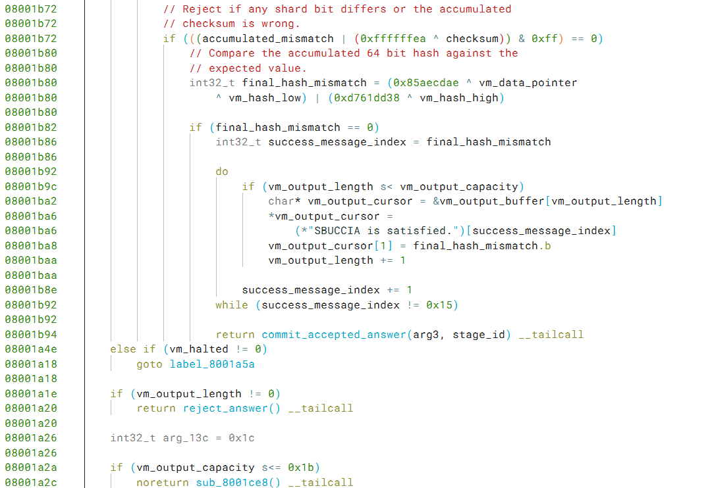

Comparing the 35 survivors against this value leaves exactly one match:

```text
D4mNAt10
```

The complete implementation is in `solve/vm_solver.py`.


## 8. Gate 5: Lucifer

Virgil displays `SEE*STAR`, which is exactly eight ASCII bytes. The answer box
expects 16 hexadecimal characters representing one encrypted 64 bit block.

### 8.1 Recovering the key

The ROM contains this masked 16-byte array:

```text
3F 3B DB F2 F8 80 86 B0 BC 49 59 05 0B 7A 69 5A
```

Each byte is recovered independently:

```text
key[i] = masked[i] XOR ((0x6D + i * 17) AND 0xFF)
```

The ROM performs this operation on demand while constructing each four byte round word.

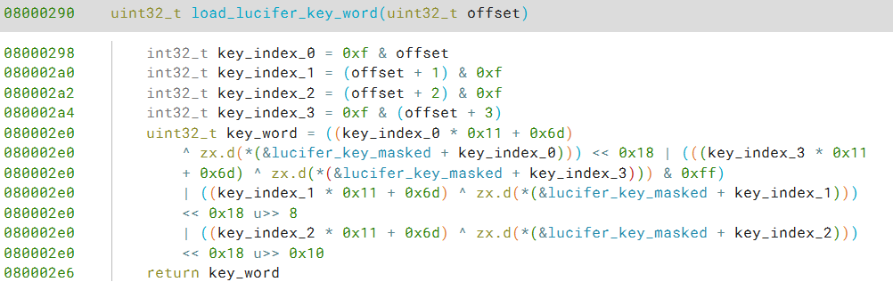

A small recovery script is enough:

```python
masked = bytes.fromhex(
    "3F 3B DB F2 F8 80 86 B0 BC 49 59 05 0B 7A 69 5A"
)

key = bytes(
    byte ^ ((0x6D + index * 17) & 0xFF)
    for index, byte in enumerate(masked)
)

print(key.decode("ascii"))
```

Output:

```text
RETRIBUTION-2026
```

### 8.2 Identifying the cipher

The checker parses exactly 16 hexadecimal characters into two 32-bit halves. It then runs the Feistel rounds backward to decrypt the submitted block and compares the result with the already visible `SEE*STAR`. 

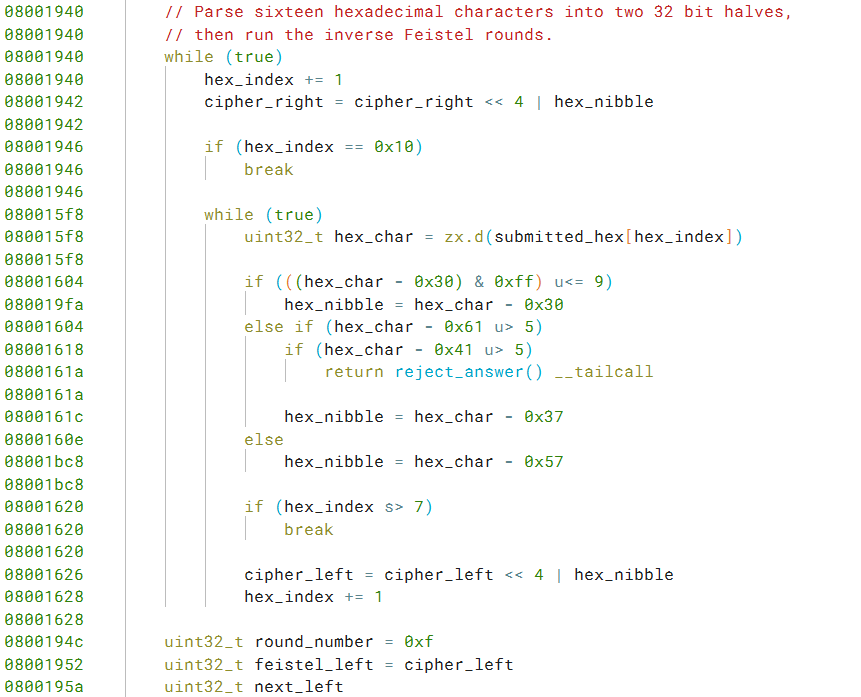

The scene name is kind of misleading, since this is not exaclty the original Lucifer implementation; it's more like a Lucifer-inspired
Feistel network.

The block is split into two big-endian 32-bit halves:

```text
plaintext = 53 45 45 2A 53 54 41 52
left      = 0x5345452A
right     = 0x53544152
```

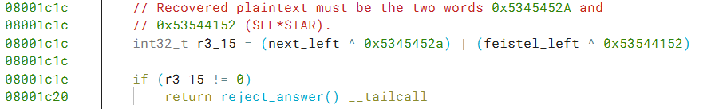

The nibble S-box is:

```text
C 5 6 B 9 0 A D 3 E F 8 4 7 1 2
```

For round `r`, two wrapped four-byte windows are read from the 16-byte key:

```text
k0 = LOAD_BE32(key[(r + 0) ... (r + 3)], wrapping modulo 16)
k1 = LOAD_BE32(key[(r + 4) ... (r + 7)], wrapping modulo 16)
round_key = k0 XOR ROL32(k1, r MOD 13)
```

The round function is:

```text
y = value XOR round_key XOR ((round * 0x9E3779B9) AND 0xFFFFFFFF)

Replace each of y's eight nibbles with the embedded S-box to obtain z.

F(value, round_key, round) =
    ROL32(z, (round MOD 7) + 3)
    + (round_key << 1)
    + 0x6C756366
```

All arithmetic is reduced modulo `2^32`. Sixteen Feistel rounds are applied:

```text
next_left  = right
next_right = left XOR F(right, round_key, round)
```

The final halves are written in big-endian order without an additional swap. The ROM applies the inverse operation to a submitted block: rounds run from 15 down to 0, with `previous_right = left` and `previous_left = right XOR F(left, round_key, round)`.

### 8.3 Complete encryption reproducer

```python
MASK32 = 0xFFFFFFFF
SBOX = (0xC, 0x5, 0x6, 0xB, 0x9, 0x0, 0xA, 0xD,
        0x3, 0xE, 0xF, 0x8, 0x4, 0x7, 0x1, 0x2)


def rol32(value, bits):
    bits &= 31
    if bits == 0:
        return value & MASK32
    return ((value << bits) | (value >> (32 - bits))) & MASK32


def load_key32(key, offset):
    return int.from_bytes(
        bytes(key[(offset + index) & 15] for index in range(4)),
        "big",
    )


def round_function(value, round_key, round_number):
    y = (value ^ round_key ^ (round_number * 0x9E3779B9)) & MASK32
    z = 0
    for nibble in range(8):
        z |= SBOX[(y >> (nibble * 4)) & 0xF] << (nibble * 4)

    return (
        rol32(z, (round_number % 7) + 3)
        + ((round_key << 1) & MASK32)
        + 0x6C756366
    ) & MASK32


def encrypt(block, key):
    left = int.from_bytes(block[:4], "big")
    right = int.from_bytes(block[4:], "big")

    for round_number in range(16):
        k0 = load_key32(key, round_number)
        k1 = load_key32(key, round_number + 4)
        round_key = k0 ^ rol32(k1, round_number % 13)
        left, right = (
            right,
            left ^ round_function(right, round_key, round_number),
        )

    return left.to_bytes(4, "big") + right.to_bytes(4, "big")


plaintext = b"SEE*STAR"
key = b"RETRIBUTION-2026"
ciphertext = encrypt(plaintext, key)
print(ciphertext.hex().upper())
```

Output:

```text
FCE3DEC2506B2F99
```

The implementation is available in  `solve/lucifer_solver.py`, which implements both encryption and the inverse routine used by the ROM:

## 09. Completing the challenge

Enter the five answers in order:

```text
GREYHOUND
24
HeavenlyMessenger:OPEN_THE_GATES_OF_DIS
D4mNAt10
FCE3DEC2506B2F99
```

After the final ciphertext is accepted, Dante and Virgil leave Hell and the epilogue displays the aggregate platform flag:

```text
srdnlen{26ECF62DF069CB44}
```
